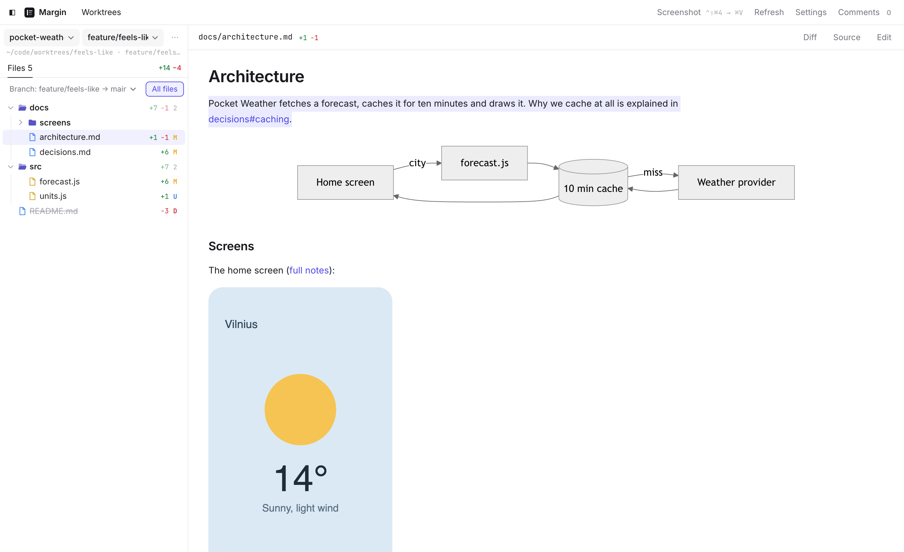

# Margin

A quiet desk beside your AI coding sessions: every git repository and worktree with its changes, Markdown with Mermaid diagrams, and comments on any line, image or screenshot that reach your Claude Code session.

This repository holds the installers only. Download them from [the latest release](https://github.com/RobertasV/margin-releases/releases/latest); the installed app keeps itself up to date from here. Margin shows git repositories, so it needs git (on Windows: [Git for Windows](https://git-scm.com/download/win)).

## macOS (Apple silicon)

Download `Margin-<version>-arm64.dmg`, open it and drag Margin to Applications. Apple has not notarized it, so the first time you open it macOS says *“Margin.app” Not Opened*. To open it:

1. Click *Done*.
2. Open System Settings → Privacy & Security and scroll down to *Security*, where it says *“Margin.app” was blocked to protect your Mac*.
3. Click *Open Anyway*, confirm with Touch ID or your password, and click *Open Anyway* once more when macOS asks.

You do this once for each copy you download; updates from inside Margin open without it. For screenshots macOS asks once to let Margin record the screen (Privacy & Security → Screen & System Audio Recording).

## Windows

Download `Margin-<version>-x64.msi` (it runs on ARM PCs too). It installs Margin for your user only, without asking for administrator rights. It is not signed, so Windows SmartScreen warns *Windows protected your PC* when you run it: click *More info*, then *Run anyway*. The screenshot shortcut is **Ctrl+Shift+0**; if it does nothing, Windows may be keeping those keys for switching keyboard layouts: choose others in Settings → Screenshot.

## Updates

A little after Margin starts, and then every hour, it looks for a newer release here, downloads the file for your computer (checked against GitHub's SHA-256) and asks to restart; if you choose later, the update is installed when you quit. Settings → Updates and Help → Check for Updates check at once.

## Questions and bug reports

Welcome in [issues](https://github.com/RobertasV/margin-releases/issues).
